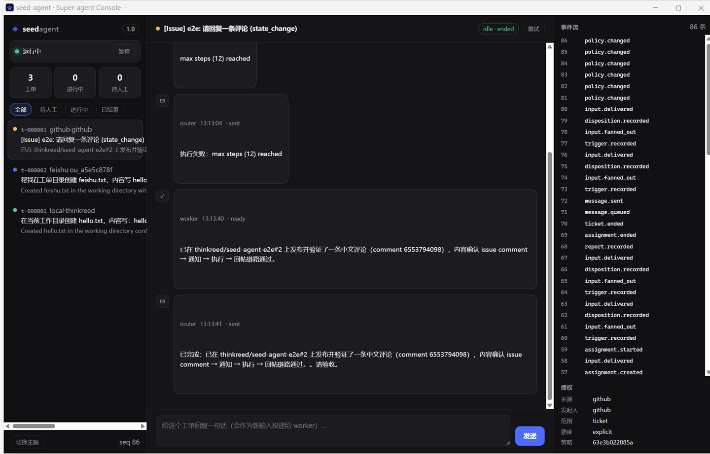

# seed-superagent

Super-agent 内核（TypeScript，零第三方依赖）：常驻 Router + 并发 Worker、事件驱动、单向状态流、可测试。

设计契约与验收清单：[docs/architecture/super-agent.md](docs/architecture/super-agent.md)；逐条核对矩阵：[docs/verification-matrix.md](docs/verification-matrix.md)。

## 运行（不需要 npm install）

要求 Node.js >= 22.18（自带 TypeScript 类型擦除与 `node:sqlite`）。

```bash
node --test "tests/*.test.ts"  # 全量测试（256 例，零网络）
npx tsc -p tsconfig.json # 类型检查（需 TypeScript；不进入运行时依赖）
node --no-warnings scripts/demo-article.mjs  # 逐条现场验证文章能力（21 项）
node --test tests/app_e2e.test.ts   # 端到端：受理 -> 工单 -> 派工 -> 报告 -> 对外回复
node --test tests/remote.test.ts    # 计算/执行分离 + 设备重连恢复
node src/cli.ts panel seed.db --json   # 机器可读面板（无库时输出空表）
```

配置文件见 `seed.config.example.json`（slots / policy / worker / prepare / 轮询间隔）。

## 真实运行（无 fake）

```bash
cp seed.config.example.json seed.config.json   # 改 model / sources
node src/cli.ts doctor seed.config.json       # 真实体检（凭证/端点/gh/飞书/文件系统）
node src/cli.ts run seed.config.json --once    # 跑一轮真实链路
node src/cli.ts run seed.config.json           # 常驻
node src/cli.ts panel seed.db                  # 只列待人工项
```

依赖的真实凭证（都通过环境变量注入，配置只写变量名）：

| 能力 | 需要 | 说明 |
|---|---|---|
| 模型 | `DEEPSEEK_API_KEY`（或自定义 `apiKeyEnv`） | OpenAI 兼容 `/chat/completions`，`model.baseUrl` 可指向任意兼容端点 |
| GitHub | `gh auth login` 已完成 | `gh api /notifications` 拉事件、`gh api .../comments` 回写 |
| 飞书 | `FEISHU_APP_ID` / `FEISHU_APP_SECRET` + 群 `chat_id` | 企业自建应用，开通 `im:message` 权限 |
| 本地验证 | 一份 `inbox.jsonl` | 每行一个 Trigger，适合本地/CI 验证整条链路 |

真实链路：Source（JSONL/gh/飞书）→ Gate → 模型评估 → 工单 → worker 进程（真实模型 + 文件/Shell 工具）→ 报告 → Router 回复 → 面板。

## 桌面版（参考 DSH 的三栏控制台）

```bash
node src/cli.ts desktop seed.config.json              # 常驻引擎 + 独立应用窗口（默认 4780）
node src/cli.ts desktop seed.config.json --no-browser # 只起服务，自己用浏览器打开
node src/cli.ts ui seed.config.json --port 4781       # 同上（别名）
.\scripts\install-desktop.ps1                         # 创建桌面/开始菜单快捷方式
```



- 三栏：工单列表（来源/阶段/摘要）· 选中工单的时间线（触发/报告/对外回复）+ 回复输入 · 事件流 + 授权信息。
- 操作：暂停/恢复引擎、重试工单、给工单回复（作为新输入投递）、深浅色切换；状态经 SSE 实时推送。
- 窗口用系统自带 Edge 的**应用模式**（WebView2/Chromium 内核）：独立窗口、无地址栏、独立 profile（`%LOCALAPPDATA%\seed-agent\ui-profile`），零 npm 依赖。
- 服务只绑定 `127.0.0.1`；可选用 `SEED_UI_TOKEN` 风格的 token 保护 API（见 `src/ui/server.ts`）。

## 结构

| 路径 | 职责 |
|---|---|
| `src/domain.ts` | 领域类型与快照（纯数据） |
| `src/events.ts` + `src/reducer.ts` | 事件表与唯一纯状态推导 |
| `src/fsm.ts` | 工单阶段派生与非法转换 |
| `src/policy.ts` + `src/context.ts` + `src/recall.ts` | 准入、Inline & Spill、链式召回 |
| `src/store.ts` + `src/effects.ts` | 事件表/outbox/cursors、stored work 退避 |
| `src/engine.ts` + `src/actions.ts` + `src/eval_runner.ts` | 唯一状态机驱动者；多 Thread Correlation 订阅 |
| `src/assessor_router.ts` + `src/router_session*.ts` | 常驻 Router（批处理/记忆/对话/recall），内核默认启用 |
| `src/executor/` + `src/daemon/` | 本地执行器、daemon 协议、stdio/HTTP 传输、远程执行器 |
| `src/sources/` + `src/channels/` | local / GitHub / 飞书 Source 与 Channel |
| `src/react.ts` + `src/jobs.ts` + `src/worker.ts` | 异步 ReAct、后台任务、可唤醒执行会话（完成后结果自动回灌） |
| `src/subagent_tool.ts` | Worker 内子任务（独立上下文，返回结构化报告） |
| `src/source_health.ts` + `src/watchdog.ts` + `src/control.ts` | Source 失败/恢复事件、外部控制回路、自然语言问答与在线策略 |
| `src/format.ts` + `src/channels/` | 多信道规范（IM ≤100 字 / 异步结构化）、GitHub/飞书/文档/邮件草稿信道 |
| `src/router.ts` + `src/panel.ts` | 面向人的短回复与只读面板 |
| `src/ui/` | 桌面控制台：HTTP/SSE 服务、视图模型、Edge 应用窗口启动器、静态资源 |

## 硬约束（由 `tests/architecture.test.ts` 守护）

1. **状态单向流动**：只有 `store.append()` 能改状态；`reducer.apply()` 是纯函数。
2. **修改收敛单点**：新事件 = `events.ts` + `reducer.ts` + 视图；同类逻辑不许两处。
3. **可测试**：时间只走 `clock.ts`，随机只走 `ids.ts`，测试零网络、零 sleep 依赖。

已知限制见设计文档 §16（Correlation、Shell 沙箱、GitHub 通知已读、凭据隔离）。